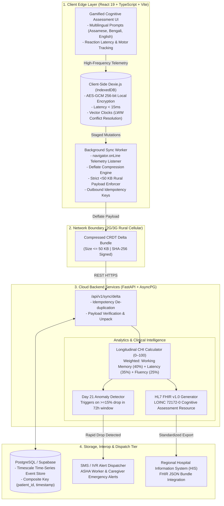

# 🧠 SmritiSetu NER (স্মৃতি সেতু)

> **Ultra-low-bandwidth, AI-driven digital biomarker & clinical telemetry platform detecting early cognitive decline (Alzheimer's & Dementia) across rural North-East India.**  
> *Engineered for intermittent 2G/3G connectivity with AES-256 encrypted offline-first edge storage, sub-50KB CRDT delta-sync, longitudinal Cognitive Health Index (CHI) analytics, and HL7 FHIR LOINC interoperability.*

---

<div align="center">

[](https://smritisetu-ner-one.vercel.app)
[](#)
[](#)
[](#)
[](#)
[](#)
[](#)
[](#)
[](#)
[](#)
[](#)
[](#)

</div>

---

## 📌 Problem & Solution Overview

### The Crisis in Rural North-East India (NER)
Over **8.8 million elderly Indians** suffer from dementia, yet rural healthcare infrastructure faces severe barriers:
- **Intermittent Connectivity:** Rural valleys operate on throttled, packet-dropped 2G/3G networks where traditional cloud-heavy medical apps crash or fail to sync.
- **Diagnostic Delay:** Cognitive symptoms are diagnosed 3–5 years late, past the therapeutic window when neuroplastic interventions are effective.
- **Linguistic Exclusion:** Existing cognitive battery tests are standardized for urban Western demographics, alienating multilingual Assamese, Bengali, and indigenous communities.

### The SmritiSetu Solution
**SmritiSetu** bridges clinical neuropsychology and resilient edge computing:
1. **Local-First Zero-Trust Edge Core:** Gamified linguistic and motor biomarker assessments run client-side with `<15ms` latency on AES-GCM (256-bit) encrypted IndexedDB storage.
2. **Strict <50 KB Delta Sync:** A network-aware background worker serializes CRDT vector clocks with binary deflate compression, guaranteeing outbound sync bundles never exceed a strict 50 KB cellular packet budget.
3. **Longitudinal Cognitive Health Index (CHI):** A rolling 30-day analytics pipeline computes a composite score (0–100) combining reaction time, working memory accuracy, and linguistic fluency.
4. **Early Anomaly Trigger:** Flags rapid cognitive drops (e.g. >15% drop over 3 days) and dispatches automated alerts to registered ASHA (Accredited Social Health Activist) healthcare workers.
5. **HL7 FHIR Interoperability:** Exports clinical observations directly mapped to LOINC standard `72172-0` for seamless ingestion by regional Hospital Information Systems (HIS).

---

## 🏗️ System Architecture



---

## ⚡ Key Technical Capabilities

| Module | Technical Implementation | Architectural Guarantee |
| :--- | :--- | :--- |
| **Edge Storage** | `Dexie.js` over IndexedDB with Web Crypto API | AES-GCM 256-bit encryption; guaranteed `<15ms` read/write latency. |
| **Conflict Resolution** | Vector Clocks + Last-Write-Wins (LWW) CRDTs | Zero data loss during weeks of disconnected offline operation. |
| **Cellular Compression** | Zlib Deflate compression worker | Outbound sync payloads guaranteed `<50 KB` on 2G/3G networks. |
| **Cognitive Scoring** | Rolling 30-day weighted harmonic mean | Longitudinal index (0–100) isolating genuine decline from momentary fatigue. |
| **Health Standard** | HL7 FHIR v1.0 Specification (`LOINC 72172-0`) | Direct plug-and-play interoperability with national ABDM/Ayushman Bharat infrastructure. |
| **Caregiver Portals** | React 19 + Recharts + Tailwind CSS | Role-based dashboards for Patients, Family Caregivers, and ASHA field workers. |

---

## 🗺️ Repository Structure

```text
smritisetu-ner/
├── docs/
│   ├── ARCHITECTURE.md          # Full architectural blueprint & synchronization mechanics
│   ├── PRD.md                   # Product Requirements Document & clinical rationale
│   └── SCHEMA.md                # Data contracts, schema definitions & FHIR mapping
├── server/                      # FastAPI Asynchronous Backend
│   ├── api/v1/                  # REST API endpoints (sync, patients, analytics, FHIR)
│   ├── core/                    # App configuration, settings & security middleware
│   ├── db/                      # SQLAlchemy models, async session & SQLite/Postgres handlers
│   ├── ml/                      # Speech biomarkers, MELO acoustic parser & clinical mapping
│   ├── schemas/                 # Pydantic v2 validation contracts
│   ├── scripts/                 # Synthetic clinical seeder & interactive demo runner
│   ├── init_db.py               # Database initialization & migrations
│   └── main.py                  # FastAPI application entrypoint
├── src/                         # React 19 Frontend Application
│   ├── components/
│   │   ├── asha/                # ASHA field worker intake & community triage HUD
│   │   ├── caregiver/           # Longitudinal patient tracking & anomaly alert feeds
│   │   ├── common/              # Shared UI primitives, buttons, modals & cards
│   │   └── games/               # Cognitive battery tasks (Memory Matrix, Stroop, Reaction)
│   ├── edge/                    # Client-side Dexie.js database & Web Crypto encryption
│   ├── ml/                      # Web Audio acoustic recording & client-side DSP feature extraction
│   ├── services/                # Axios API clients & FHIR export parsers
│   ├── sync/                    # CRDT vector clocks & background sync worker
│   ├── App.tsx                  # Core application shell & role-based view routing
│   └── main.tsx                 # React DOM mount point
├── tests/                       # Complete Test Suites
│   ├── edge/                    # Dexie.js offline reads, writes & vector clocks
│   ├── sync/                    # CRDT delta-sync compression & 50 KB budget tests
│   ├── server/                  # FastAPI endpoints, anomaly logic & CHI formulas
│   └── integration/             # End-to-end runbook & multi-client sync tests
├── run_all.bat                  # One-click Windows development bootstrapper
├── run_all.ps1                  # One-click PowerShell development launcher
├── vite.config.ts               # Vite bundler configuration
├── requirements.txt             # Pinned backend Python dependencies
├── package.json                 # Frontend dependencies (React 19, Dexie, Recharts)
└── README.md                    # Platform documentation & architecture guide
```

---

## 🚀 Getting Started & Local Setup

### Prerequisites
- **Node.js**: v18.0.0 or higher
- **Python**: v3.10.0 or higher
- **npm** or **pnpm**

---

### Step 1: Clone Repository
```bash
git clone https://github.com/Aryan9891/smritisetu-ner.git
cd smritisetu-ner
```

---

### Step 2: Environment Configuration
Create your environment variable file from the provided template:

```bash
# Frontend configuration
cp .env.example .env
```

`.env` configuration keys:
```env
# Backend REST Endpoint
VITE_API_URL=http://127.0.0.1:8000

# Authentication (Optional Clerk integration)
VITE_CLERK_PUBLISHABLE_KEY=pk_test_placeholder_key
```

---

### Step 3: Install & Start Cloud Backend (Terminal 1)
```bash
# Set up Python virtual environment
python -m venv .venv

# Activate virtual environment
# Windows:
.venv\Scripts\Activate.ps1
# macOS/Linux:
# source .venv/bin/activate

# Install backend dependencies
pip install -r requirements.txt

# Start FastAPI server
uvicorn server.main:app --host 0.0.0.0 --port 8000 --reload
```
- **Backend API**: [http://localhost:8000](http://localhost:8000)
- **Interactive Swagger Docs**: [http://localhost:8000/docs](http://localhost:8000/docs)
- **Health Check**: [http://localhost:8000/health](http://localhost:8000/health)

---

### Step 4: Install & Start Client Edge (Terminal 2)
```bash
# Install frontend dependencies
npm install

# Start Vite development server
npm run dev
```
- **Web Portal**: [http://localhost:5173](http://localhost:5173)

---

### Option B: One-Click Full-Stack Launcher (Windows)
```powershell
.\run_all.ps1
# or
.\run_all.bat
```

---

## 🧪 Testing Suites

Run client-side edge tests and backend anomaly pipelines:

```bash
# 1. Run Edge Storage & CRDT Compression Tests (Vitest)
npm run test tests/edge/db.test.ts
npm run test tests/sync/crdt_sync.test.ts

# 2. Run Server-Side CHI & Anomaly Tests (Pytest)
python -m pytest tests/server/test_api_sync.py -v
python -m pytest tests/server/test_analytics_anomaly.py -v
python -m pytest tests/integration/test_runbook.py -v -o asyncio_default_test_loop_scope=function
```

---

## 🏆 Live Interactive Terminal Pitch & Simulation
Execute the terminal pitch runner showcasing edge writes, sub-50KB delta-sync, and FHIR export:

```bash
# Seed synthetic patient longitudinal trajectory
python -m server.scripts.seed_demo_data

# Run interactive simulation
python -m server.scripts.demo_runner
```

---

## 📄 License & Attribution

Distributed under the MIT License. Developed by **Aryan Sachin** (`Aryan9891`) for the North-East India healthcare access and cognitive health surveillance initiative.
